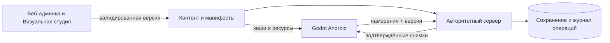

# Архитектура: требования и технический проект

## Что существует

На `b3ed870` — только README.md. Godot-проект, сервер, БД, транспорт и админка отсутствуют.
В среде доступен Godot 4.6.3; это установленный инструмент, не версия проекта и не успешная сборка.
Ни один описанный далее модуль не объявляется реализованным.

## Обязательная архитектурная граница

Источник: [DEV-FOUNDATION-001](DECISIONS_INDEX.md#dev-foundation-001), базовые требования,
CONTROL-SHIP-ONLY, LOCATION-001, ART-MAGIC-SHIPS-DRONES.

- Android/Godot 4, горизонтальная ориентация, 3D-объекты в 2.5D, звёздный фон 2D.
- Игрок управляет кораблём; пешего персонажа нет. Атаки кораблей/дронов магические.
- Авторитетный сервер на собственном VPS владеет движением, боем, прогрессом, экономикой и наградами.
- Первая система разделена на области; сервер и клиент ограничивают доступ и видимость.
- Модульные контракты заранее; сложные системы добавляются после проверенного малого среза.
- Админка расширяется вместе с механикой; Визуальная студия появляется одной из первых.
- Ресурсы версионируются, догружаются по областям и кэшируются; APK обновляет Android с проверкой подписи.
- Производительность и память измеряются с первого клиента, а не только перед релизом.

## Предложенный стек — ещё не принятый ADR

| Слой | Что утверждено | Техническое предложение из источника | Что решить в FOUNDATION-001 |
| --- | --- | --- | --- |
| Клиент | Godot 4 | GDScript или C# | Версия движка/экспорта, язык и renderer по Android-проверке |
| Сервер | Авторитетность, VPS | Go | Язык/версия, тик, процесс зоны, тестовый вход |
| Сеть | Онлайн, серверные проверки | HTTPS + WebSocket либо обоснованный иной транспорт | Схема команд/снимков, версии, reconnect, TLS |
| Хранение | Надёжное сохранение | PostgreSQL, миграции, транзакции | Схемы, ключи операций, тестовая БД, восстановление |
| Админка | Веб и Визуальная студия | React/TypeScript | Минимальный UI/API, роли и журнал |
| Окружение | Воспроизводимость, секреты вне Git | Docker Compose | Проверить совместимость; не требовать доступ к VPS для локального старта |

Не фиксировать числовой тик, число игроков, FPS, размер APK и цены как утверждённые значения.
Проверку нового стека можно сделать локальным временным smoke в следующем задании;
в текущем задании игровые исходники не создаются.

## Поток данных малого среза

Аутентификация не даёт права произвольно менять состояние.
Клиент не отправляет доверенный урон, награду, XP, баланс или окончательную позицию.
Тестовые платежи не подделывают реальные подтверждения провайдера.

## Модули и контракты

| Модуль | Владеет | Не должен делать | Первый проверяемый результат |
| --- | --- | --- | --- |
| Session/Foundation | Сессия, ID, протокол, версии, время | Вычислять клиентский баланс как истину | Два разных тестовых игрока |
| World/Movement | Область, проходимость, движение, интерес | Загружать всю галактику или доверять телепорту | Серверный полёт и препятствие |
| Combat | Цель, магическое действие, HP/щит, исход | Выдавать клиентскую добычу без транзакции | Один враг и одна победа |
| Content | Квест, диалог, личное состояние, обучение | Переписывать общий мир личным выбором | NPC → квест → награда |
| Progression/Equipment | XP, потолок, класс, слоты, БМ | Обходить уровень чертежом; терять старый класс | Проверенный модуль и открытие |
| Economy | Инвентарь, валюты, журнал выдач | Повторять награду при replay | Один ключ операции — одна выдача |
| Social | Членство, права, разрешённые маркеры | Отправлять приватные координаты | Пати двух сессий |
| AI | Наблюдения и намерения пилота | Обходить серверный валидатор | Один ограниченный маршрут |
| Drones | Помощник, развитие, умения, модули | Выдумывать формат отдельной арены | Один сохраняемый помощник |
| Monetization | Гача/VIP/BP/права предложений | Смешивать независимые XP или доверять клиентской оплате | Бесплатный тестовый сценарий |
| Admin | Настройка, превью, публикация и аудит | Публиковать канон через непроверенное ИИ-редактирование | Карточки и откат версии |
| Distribution | Манифест, хеш, загрузка, кэш | Бесшумно заменять установленный APK | Обрыв загрузки без порчи набора |

## Дорогие решения, которые нужно учесть до кода

FOUNDATION-002 фиксирует ID персонажа/корабля/зоны/контента, единицы времени,
версию протокола, sequence и правила удаления/повтора сообщений.
FOUNDATION-003 задаёт транзакции и идемпотентные операции, сохранение после обрыва,
границы атомарной публикации и совместимость конфигурации с сервером/клиентом.
Общий интерфейс намерений для человека и ИИ закладывается здесь, поведение ИИ — позднее.
Не делать микросервисы, распределённые зоны и универсальный визуальный редактор заранее.

## Android с начала разработки

Объекты повторяются через MultiMesh только там, где это полезно по измерениям.
LOD, видимость, текстурная память, прозрачные VFX и загрузка по областям получают бюджет.
Профили качества могут начинаться с технического шаблона из трёх уровней;
конкретные renderer/профили проверяются на устройстве, не считаются утверждённым балансом.
PERF-001 задаёт воспроизводимый протокол, PERF-002 базовую линию, PERF-003 сравнение,
PERF-004 регрессии. До замеров нет численных обещаний.

## Будущие пути — предложение, не наличие кода

`client/`, `server/`, `admin/`, `content/`, `infra/`, `tests/` могут быть приняты в ADR.
Не создавать их пустыми ради видимости прогресса. Точный allowlist следующего пакета — в TASK.
Текущий пакет FOUNDATION-001 изменяет только Markdown-контракты, не этот каркас.
